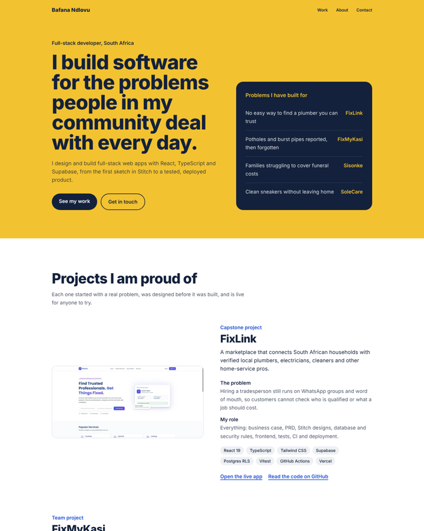

# Bafana Ndlovu: portfolio

My personal portfolio: who I am, the projects I am proud of, my skills, and how to contact me.

**Live site:** _add your Vercel link here after the first deploy_



## What's on it

- **Hero:** what I build, plus the real community problems I have built apps for
- **Projects:** FixLink (capstone), FixMyKasi (team project) and Pulse, each with a screenshot, the problem, my role, the tech stack, and live and GitHub links
- **More builds:** Sisonke, SoleCare and TaskForge API
- **About and skills**
- **Contact:** email, LinkedIn, GitHub and CV download

## Tech stack

React 19, TypeScript, Vite and Tailwind CSS 4, deployed on Vercel. Fonts are Bricolage Grotesque and Public Sans from Google Fonts.

## Run it locally

```bash
npm install
npm run dev       # http://localhost:5173
npm run lint
npm run build     # type-check and production build
```

## Updating the content

All text, links and projects live in [`src/content.ts`](src/content.ts), so adding a project or changing contact details never means touching the layout. Project screenshots go in `public/projects/` and the CV PDF in `public/`.

A contact link that is left empty is not shown, so the site never has broken links.
